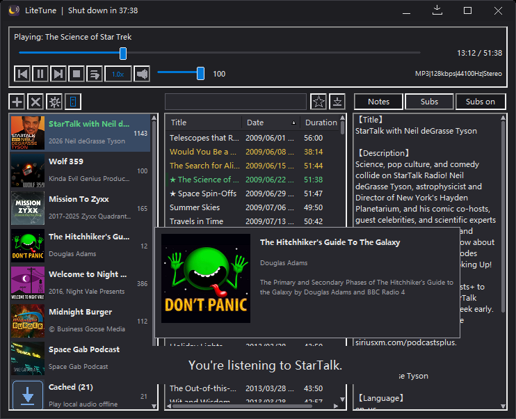

# LiteTune

[English](README.md) | 简体中文

**极简、绿色便携的 RSS 播客播放器** —— 纯 C 语言 + 原生 Win32 API，单个 32 位可执行文件（约 300 KB），Win7–Win11 32/64 位通用。无需安装、不依赖任何第三方 DLL，不写注册表，删除 exe 即完全卸载。


[](https://deepwiki.com/EARTH-CODE-42/win32-podcast)
[](https://alternativeto.net/software/litetune/about/?utm_source=badge&utm_medium=referral)

[](https://sourceforge.net/projects/litetune/)



> 左：桌面端（暗色主题）· 右：手机浏览器打开的「手机出声 / 遥控」网页

## 演示视频

免安装、手机遥控、离线缓存全流程：


https://github.com/user-attachments/assets/e0595a50-6e5e-40c9-91ec-232fd2d9ec43


## 功能

- RSS 播客订阅管理（添加 / 删除 / 调整顺序 / 刷新），单实例运行
- **右键菜单**：播客列表右键可刷新 / 删除订阅 / 删除该播客缓存；缓存视图右键可清空全部缓存 / 打开缓存文件夹；剧集右键可播放 / 下载 / 删除该集缓存 / 打开所在位置（右键同时选中该行）；多选时菜单会多出「删除选中的 N 集缓存」，一次清掉所选剧集的音频
- 剧集列表（标题、日期、时长，列头点击排序）；缓存视图额外支持按播客名列排序
- **简介区可折叠**：鼠标移到面板左缘中间才浮出一个小窄条按钮，点击收起右侧简介、剧集列表自动铺满；收起后按钮移到剧集右缘（图案变 `‹`），点击恢复。折叠状态记在配置里，亮色 / 暗色主题都有同款按钮
- **字幕支持**：自动读取 RSS 的 `podcast:transcript`（VTT / SRT），也可在剧集右键「手动填写字幕地址」指定；简介区可一键切到「字幕」视图（状态记忆），字幕列表随播放进度高亮自动滚动，点击任一条跳到该句，悬停显示完整文本，横向长句有自绘横条
- **桌面字幕窗**：置顶悬浮窗实时显示当前句（间隙时沿用上一条，不闪烁）；拖动任意处移动、边缘缩放；字号随窗口高度自动取「正好两行」的基准，长句自动缩小不被截断；左键从当前句开始播、滚轮切换上下句、右键暂停/继续；鼠标移入才显示右上角 × 可关闭外挂字幕；主窗口最小化不受影响
- 在线播放与本地缓存：音频自动下载到缓存目录，断网也能离线收听
- **本地缓存视图**：播客列表最后一行「已缓存 (N)」，点开即可浏览、播放所有已下载剧集（不联网，断网时尤其好用）
- **订阅缓存**：订阅 RSS 与封面图缓存到本地，启动直接读缓存（秒开、无需联网），断网也能浏览订阅列表；手动刷新联网取最新，联网失败自动回退缓存（列表不清空）
- **订阅源兼容性**：自动读取系统代理设置（如 Clash），FeedBurner、BBC、Buzzsprout 等源均可正常解析；接受所有 2xx 响应码
- **JSON Feed 支持**：除 RSS / Atom 外，也可以直接订阅 [jsonfeed.org](https://jsonfeed.org) 格式的源
- 加载进度：订阅加载 / 刷新时状态栏实时显示「已加载 x/n」，网速慢一眼可辨
- **新剧集角标**：刷新后若发现新剧集，播客列表右侧显示红色未读数字（超过 99 显示 99+）；点开该播客即清零，未点开的角标重启后依然保留
- **定时自动刷新**：设置菜单可选 关 / 30 / 60 / 120 / 360 分钟，空闲时自动联网更新全部订阅（播放、下载、批量缓存期间自动跳过，不打断收听）
- **批量缓存**：剧集列表按住拖动 / Ctrl+点击 多选任意剧集，点下载按钮一次缓存（已缓存的自动跳过，不打断当前播放）
- 续播记忆：退出时记住正在听的剧集和位置，下次启动自动续播；退出时处于暂停状态则恢复为暂停待播（手动停止过则不续播）
- 每播客"上次听到"标记：每个订阅记住最近一集（列表橙色高亮），双击它直接从上次的位置接着听
- **双击播客快速续播**：双击左侧播客，直接播放该播客的橙色剧集并从记录位置续播；没有橙色记录则自动从第 1 集开始
- **先下后播，不打断当前收听**：双击还没缓存的剧集时，它在后台下载，正在播的那一集继续放；下载完成才自动切过去（缓存在别的目录切换过程中也照样落到新目录）
- **剧集收藏**：剧集右键「收藏」，列表标题前显示 ★；多选可批量收藏 / 取消；点上方星形按钮只看已收藏；收藏记录写入配置，重启保留
- **剧集即时过滤**：剧集面板顶部输入关键词即实时筛选标题（大小写不敏感），可与「只看已收藏 / 已缓存」叠加
- **新剧集提示音**：刷新发现新剧集时播放提示音，托盘图标同步显示数量角标；设置菜单可关
- **每播客刷新间隔**：播客右键可为单个订阅单独设置刷新间隔（跟随全局 / 关 / 30–360 分钟）
- 右键可复制剧集音频地址 / 订阅源地址到剪贴板
- 订阅导入 / 导出：导出 OPML 订阅列表（与其它播客应用互通）；导入 / 导出完整配置（.ini），备份、换机一键恢复
- **播客搜索**：在「添加订阅」框里输入关键词（不带 `://` 的普通文字），回车或点「确定」按钮即从 iTunes 查找，结果列表里单击即把 RSS 地址填回输入框（再按一次回车直接添加），双击也可一键添加
- 播放控制：上一曲 / 播放暂停 / 下一曲 / 停止 / 静音 / 音量
- 播放模式：顺序播放 / 随机播放 / 单曲循环 / 一次性播放（播完本集即停）
- 倍速播放：0.5x–3.0x（0.75 / 1 / 1.25 / 1.5 / 2 快捷档）
- 进度条拖动定位；播放中剧集绿色、已缓存黄色、"上次听到"橙色高亮（暂停时绿色依然保留）
- **「定位正在播放」按钮**：当前播客的绿行滚出可视区、且鼠标在剧集面板里时，右下角浮出一个小圆币按钮（三角指向绿行所在方向），点一下即把它滚到列表中段
- **手机播放 / 遥控**：设置菜单开启后，手机浏览器打开局域网网页即可——播放控制、进度条拖动定位、音量调节、选集播放、播放模式与倍速切换、定时关机；支持锁屏媒体控制
- 系统托盘：点 × 直接退出；最小化收纳到托盘；鼠标移到托盘图标即弹出迷你控制浮窗（上一曲/播放暂停/下一曲/随机，离开自动收起），双击恢复主窗口
- **托盘气泡提醒**：窗口收在托盘时，刷新发现新剧集会在托盘气泡里提示总数量（窗口可见时不打扰）
- 多媒体键盘媒体键（播放/暂停、上一曲、下一曲、停止）
- 方向键快捷操作：←/→ 快退 / 快进 15 秒，↑/↓ 上一曲 / 下一曲；焦点在列表 / 编辑框 / 滑块 / 滚动条时，方向键仍归控件自己使用
- 亮色 / 暗色主题（运行时即时切换，标题栏、设置菜单、右键菜单、悬停提示统一配色）
- 中英文双语界面（首次运行选择语言，设置菜单随时切换，自动记忆）
- 定时关机（预设 15–120 分钟或自定义 1–600 分钟，标题栏显示倒计时；到点强制关机，系统提供 15 秒取消窗口）
- 启动时自动清理旧缓存：默认 30 天，设置菜单可改 关 / 7 / 30 / 90 天（只删程序自己生成的音频文件，自定义目录同样安全）
- 三档字号调节（Ctrl + 鼠标滚轮）
- 可自定义缓存目录（支持打开 / 更改 / 移动已有缓存）；切换时若目标目录有同名文件会拒绝切换，避免覆盖你的数据；下载进行中切换目录，下完的音频也会落到新目录
- **配置存储双模式**：可内嵌到 exe（单文件便携，复制即带走）或外挂为同目录 `feeds.ini`（便于升级 / 备份 / 手动编辑）；首次运行弹窗选择，设置菜单随时切换（详见「配置存储」）
- 任务栏缩略图按钮：上一曲 / 播放暂停 / 下一曲 / 随机下一曲（图标随系统浅 / 深色主题自适应）
- 鼠标悬停提示：按钮说明、剧集完整文本、播客封面 + 标题 + 作者
- 原创夜空弯月应用图标（窗口 / 任务栏 / 资源管理器统一）

## 快捷键

| 按键 | 功能 |
|------|------|
| `空格` | 播放 / 暂停 |
| `←` / `→` | 快退 / 快进 15 秒（焦点不在列表、编辑框、滑块、滚动条时） |
| `↑` / `↓` | 上一曲 / 下一曲（同上） |
| `媒体键` | 播放/暂停、上一曲、下一曲、停止 |
| `Ctrl+滚轮` | 切换字号 |
| `ESC` | 退出程序（添加订阅弹窗打开时仅关闭弹窗） |

## 文件说明

| 文件 | 说明 |
|------|------|
| `LiteTune.exe` | 主程序（绿色单文件；配置可内嵌于 exe 尾部，或外挂为同目录 `feeds.ini`，见「配置存储」） |
| `main.c` | 全部源代码 |
| `feeds.ini` | （可选）外挂配置文件，格式与旧版一致。仅「外挂」模式（或首次运行选择外挂）下存在；内嵌模式下不存在 |
| 缓存目录 | 已下载音频（文件名 = URL 哈希）、订阅与封面缓存（`feed_*.xml` / `cover_*.img`）。默认存 `%TEMP%\LiteTune\`，Windows 自动清理；手动选择过其它目录则存在 ini 里。删除订阅时自动清理对应的订阅/封面缓存（音频保留） |
| `resource.rc` / `app.manifest` / `app.ico` | 编译资源（DPI 感知清单、图标） |
| `screenshot.png` | README 展示用界面截图（桌面端 + 手机网页） |
| `litetune-demo.mp4` | 演示视频（免安装 / 手机遥控 / 离线缓存） |
| `LICENSE` | MIT 许可证 |
| `tools\make_ico.ps1` | 图标生成脚本（改图标后运行，再重新编译） |

## 配置存储

配置与订阅源可以**内嵌在 exe 尾部**，也可以**外挂为同目录的 `feeds.ini`**。采用哪种模式不由配置项决定，只由磁盘现状决定，启动时按以下优先级自动判定：

1. 同目录存在 `feeds.ini` → 用**外挂**配置（exe 尾部若有内嵌配置，一律忽略）；
2. 否则 exe 尾部有内嵌配置 → 用**内嵌**配置；
3. 两者都没有（首次运行）→ 弹出首启弹窗，让你选择界面语言并选择存储方式（关闭该弹窗＝退出程序）。

之后可在**设置 → 配置存储位置**随时切换，当前模式在菜单里以勾选显示：

- **内嵌到程序内**：配置写进 exe 尾部（PE overlay，魔数 `LTST`）。真正的单文件便携，复制 exe 到 U 盘或别的电脑＝连配置一起带走。切换时会先弹窗征求同意，再删除同目录 `feeds.ini`。
- **外挂 `feeds.ini`**：配置保存为 exe 同目录的 `feeds.ini`，便于升级、备份、手动编辑。切换时会剥离 exe 尾部的内嵌配置，避免把订阅随 exe 分发出去。

两种模式采用完全相同的配置格式（与旧版 `feeds.ini` 一致）：

```ini
[settings]
sort=date:desc        ; 排序列: title/date/duration，方向: asc/desc
w1=323                ; 播客列宽占比（千分比）
w2=383                ; 剧集列宽占比（千分比）
deschide=1            ; 简介区已折叠（1=收起，仅收起时写入）
subon=0               ; 字幕开关关闭（默认开，仅关闭时写入）
subview=1             ; 简介区显示字幕列表（默认简介，仅字幕视图时写入）
cw0=110               ; 剧集列表三列像素宽
cw1=88
cw2=44
vol=80                ; 音量 0-100
speed=100             ; 倍速（百分数，100 = 1.0x，50-300）
font=0                ; 字号级别 0/1/2
dark=0                ; 暗色模式 0/1
lang=zh               ; 界面语言 zh/en
winw=480              ; 窗口尺寸（客户区）
winh=360
winx=100              ; 窗口位置（记住上次摆放处）
winy=100
cachedir=             ; 缓存目录（留空 = 默认 %TEMP%\LiteTune）
cachedays=30          ; 缓存自动清理天数（0=关；默认 30，非默认才写入）
autorefresh=60        ; 自动刷新间隔（分钟，0=关；默认 60，非默认才写入）
traysound=0           ; 新剧集提示音关闭（默认开，仅关时写入）
podrefresh=1a2b3c4d,60 ; 单播客刷新间隔（哈希,分钟；-1=跟随全局 0=关），每个订阅一条
fav=1a2b3c4d,https://... ; 已收藏剧集（播客URL哈希,剧集URL），每集一条
seenep=1a2b3c4d,0,20250812 ; 每播客"已看"水位（哈希,高位,低位），新剧集角标用，每个订阅一条
resume=1234           ; 上次退出时的播放位置（秒，自动续播用）
resumeplay=1          ; 退出时是否在播放（0=暂停，重开后定位到位但保持暂停）
resumeurl=...         ; 上次退出时正在播的剧集 URL
lastep=1a2b3c4d,567,  ; 每播客"上次听到"（哈希,秒,剧集URL），每个订阅一条

[transcripts]
trans=1a2b3c4d,https://example.com/ep1.vtt ; 手动指定的单集字幕地址（剧集URL哈希,字幕地址），每集一条

[feeds]
https://example.com/feed1.xml
https://example.com/feed2.xml
```

> 配置仅在启动时读取、退出时保存，运行中不锁定。续播 / 上次听到记录在退出时写入，启动时自动清理已删除订阅的残留。
>
> 保存流程：按当前模式落地——外挂模式直接覆盖写 `feeds.ini`；内嵌模式把配置写进自身 exe 尾部并读回校验（运行中的 exe 本体不能改写，走「新镜像写 exe.new → 旧镜像挪进临时目录 → 原子改名顶上」的换装流程，exe 所在目录不留临时文件）。内嵌写失败（只读介质等）时自动回退覆盖写 `feeds.ini`。

## 手机遥控

设置菜单勾选「手机播放/遥控」后，状态栏会显示访问地址（首次开启系统会询问防火墙权限，点「是」）。手机浏览器打开该地址即可：

- 显示当前播放标题与进度，可直接拖动进度条定位、拖动音量条调节
- 播放/暂停、上一曲、下一曲、停止、±15 秒
- 选集播放：下拉选播客，点任意一集电脑立即播放
- 播放模式切换（顺序/随机/循环/播完停）与倍速快捷档
- 定时关机：预设 15/30/60 分钟、自定义分钟数或取消

## 编译

主力构建为 **32 位**（Win7–Win11 32/64 位通用）。项目自带便携工具链 `mingw32\`（winlibs i686-msvcrt gcc 15.2.0，msvcrt 运行时为 Win7 原生自带，无需额外 DLL）：

```powershell
.\mingw32\bin\windres.exe resource.rc -O coff -o resource32.o
.\mingw32\bin\gcc.exe -Os -s -mwindows -municode -std=gnu17 -Wall -Wextra `
    '-D_WIN32_WINNT=0x0601' '-fno-unwind-tables' '-fno-asynchronous-unwind-tables' `
    '-Wl,--subsystem,windows:6.01' `
    -o LiteTune.exe main.c resource32.o `
    -lwinhttp -lwinmm -lole32 -luuid -lshlwapi -lcomctl32 -lshell32 `
    -lpropsys -lws2_32 -liphlpapi -lgdiplus -ladvapi32 -lcomdlg32 `
    -lmf -lmfplat -lmfplay -lmfreadwrite
```

若用其它 MinGW-w64 32 位工具链，同样参数即可（注意选 msvcrt 而非 ucrt 运行时，否则 Win7 上缺 ucrtbase.dll 无法启动）。

## 系统要求

- Windows 7 及以上（32/64 位通用，单 exe 免安装）
- 最小窗口尺寸 480×360（客户区）
- 手机遥控需同一局域网

## 关于 AI 辅助开发

本项目在开发过程中使用 AI 编程助手（Trae）进行辅助，具体包括：

- **代码编写**：界面布局、控件自绘、RSS 解析、WinHTTP 下载、Media Foundation 播放、手机遥控服务等模块由人与 AI 协作完成
- **问题排查**：编译错误、暗色主题重绘、控件子类化、图标量化编码等问题借助 AI 分析定位
- **代码整理**：多语言字符串表抽取、冗余代码清理、注释与文档更新

程序的整体设计、功能取舍（如 ESC 直接退出、单文件无依赖、默认中文、绿色无痕不写注册表）由作者决定；所有代码均经作者确认。源代码不包含任何遥测、统计或网络数据上报行为（手机遥控仅在本机局域网监听，不连接外部服务器）。

## 许可证

[MIT](LICENSE) © 2026 Lincos
