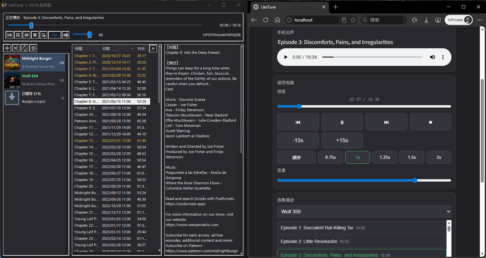

# LiteTune

English | [简体中文](README.md)

**Minimalist, portable RSS podcast player** — pure C + native Win32 API, a single 32-bit executable (about 256 KB), works on Windows 7–11 (32/64-bit). No installation, no third-party DLLs, no registry writes — delete the exe and it's fully uninstalled.


[](https://deepwiki.com/EARTH-CODE-42/win32-podcast)
[](https://alternativeto.net/software/litetune/about/?utm_source=badge&utm_medium=referral)
[](https://sourceforge.net/projects/litetune/)



> Left: desktop (dark theme) · Right: the phone remote page opened in a mobile browser

## Features

- RSS podcast subscription management (add / delete / reorder / refresh), single-instance
- Episode list (title, date, duration; sortable by column headers)
- Online playback and local caching: audio auto-downloads to the cache folder, listen offline without network
- **Feed cache**: RSS and cover art cached locally — instant startup from cache (no network needed), browse feeds offline; manual refresh fetches the latest and falls back to cache on failure (list is never cleared)
- Loading progress: status bar shows "loaded x/n" while loading/refreshing feeds
- **Batch caching**: drag or Ctrl+click to multi-select episodes, hit the download button to cache them all (already-cached ones are skipped, playback is never interrupted)
- Resume memory: remembers the episode and position on exit, resumes automatically next launch (not written if you stopped manually)
- Per-podcast "last heard" marker: each feed remembers its latest played episode (orange highlight); double-click to resume right where you left off
- Playback controls: previous / play-pause / next / stop / mute / volume
- Play modes: sequential / shuffle / repeat one / play once (stop after this episode)
- Playback speed: 0.5x–3.0x (quick presets 0.75 / 1 / 1.25 / 1.5 / 2)
- Seekable progress bar; green while playing, yellow when cached, orange for "last heard"
- **Phone playback / remote**: enable in the Settings menu, open the LAN page in your phone browser — playback controls, seekable progress bar, volume, episode picker, play mode & speed, sleep timer; lock-screen media controls supported
- System tray: click × to exit directly; minimize to tray; tray left-click pops a mini control flyout (prev/play/next), double-click restores the main window
- Multimedia keyboard media keys (play/pause, previous, next, stop)
- Arrow keys navigate lists and buttons (click anywhere first, then use arrows)
- Light / dark theme (switched at runtime)
- Bilingual UI, English & Chinese (chosen on first run, switchable in the Settings menu, remembered)
- Sleep timer (presets 15–120 min or custom 1–600 min, countdown in the title bar; force shutdown at the end, Windows gives a 15-second cancel window)
- Auto-clean cache older than 30 days at startup (default %TEMP% folder only; custom folders are never touched)
- Three UI font sizes (Ctrl + mouse wheel)
- Custom cache folder (open / change / move existing cache)
- **Dual-mode config storage**: embed it in the exe (single-file portable — copying the exe takes it along) or keep it as an external `feeds.ini` next to the exe (easy upgrades / backups / manual editing); chosen on first run, switchable anytime in the Settings menu (see "Config storage")
- Taskbar thumbnail toolbar: previous / play-pause / next / shuffle-next
- Tooltips: button hints, full episode text, podcast cover + title + author
- Original crescent-moon app icon (window / taskbar / Explorer)

## Keyboard

| Key | Action |
|------|------|
| `Space` | Play / pause |
| `Arrow keys` | Move focus / selection in lists and buttons |
| `Media keys` | Play/pause, previous, next, stop |
| `Ctrl+Wheel` | Switch font size |
| `ESC` | Quit the app (closes the add-feed dialog only when it's open) |

## Files

| File | Description |
|------|------|
| `LiteTune.exe` | Main program (portable single file; the config is either embedded in the exe tail or kept as an external `feeds.ini` next to it — see "Config storage") |
| `main.c` | All source code |
| `feeds.ini` | (optional) External config file, same format as the legacy one. Present only in "external" mode (or when chosen on first run); absent in embedded mode |
| Cache folder | Downloaded audio (filename = URL hash), feed & cover cache (`feed_*.xml` / `cover_*.img`). Defaults to `%TEMP%\LiteTune\`, auto-cleaned by Windows; stored in the ini if you pick a custom folder. Deleting a feed cleans its RSS/cover cache (audio is kept) |
| `resource.rc` / `app.manifest` / `app.ico` | Build resources (DPI-aware manifest, icon) |
| `screenshot.png` | Screenshot for the README (desktop + phone web) |
| `LICENSE` | MIT license |
| `tools\make_ico.ps1` | Icon generator (run after changing the icon, then rebuild) |

## Config storage

The config and feed list can be **embedded in the exe tail** or kept as an **external `feeds.ini` next to the exe**. Which mode is used is not decided by any config key — only by what's on disk — and is auto-detected at startup in this order:

1. A `feeds.ini` exists next to the exe → **external** config is used (an embedded tail, if any, is ignored);
2. Otherwise the exe has an embedded config in its tail → **embedded** config is used;
3. Neither exists (first run) → a first-run dialog asks you to pick the UI language and the storage mode (closing the dialog = quit the app).

You can switch anytime under **Settings → Config Storage**; the current mode is shown with a check mark:

- **Embedded in program**: the config is written into the exe tail (PE overlay, magic `LTST`). Truly single-file portable — copy the exe to a USB stick or another PC and the config comes along. Switching asks for confirmation first, then deletes the `feeds.ini` next to the exe.
- **External `feeds.ini`**: the config is saved as `feeds.ini` next to the exe, convenient for upgrades, backups, and manual editing. Switching strips the embedded tail so your subscriptions aren't shipped along with the exe.

Both modes use exactly the same config format (identical to the legacy `feeds.ini`):

```ini
[settings]
sort=date:desc        ; sort column: title/date/duration, direction: asc/desc
w1=323                ; podcast column width (per-mille)
w2=383                ; episode column width (per-mille)
cw0=110               ; episode list column widths in pixels
cw1=88
cw2=44
vol=80                ; volume 0-100
speed=100             ; playback speed (percent, 100 = 1.0x, 50-300)
font=0                ; font size level 0/1/2
dark=0                ; dark mode 0/1
lang=zh               ; UI language zh/en
winw=480              ; window size (client area)
winh=360
cachedir=             ; cache folder (empty = default %TEMP%\LiteTune)
resume=1234           ; last playback position in seconds (for auto resume)
resumeurl=...         ; URL of the episode playing at last exit
lastep=1a2b3c4d,567,  ; per-feed "last heard" (hash,seconds,episode URL), one line per feed

[feeds]
https://example.com/feed1.xml
https://example.com/feed2.xml
```

> The config is read at startup and saved at exit only; nothing is locked while running. Resume / last-heard records are written at exit; stale entries of deleted feeds are cleaned at startup.
>
> Save flow: saved according to the current mode — external mode overwrites `feeds.ini` directly; embedded mode writes the config into the exe tail and reads it back for verification (a running exe can't be rewritten, so the new image is written to exe.new, the old image is renamed into the temp folder, then exe.new is atomically renamed over — the exe folder stays clean). If the embedded write fails (read-only media), it falls back to overwriting `feeds.ini`.

## Phone remote

After enabling "Phone playback / remote" in the Settings menu, the status bar shows the address (the first time, Windows asks about firewall permission — click "Yes"). Open it in your phone browser:

- Shows the current title and progress, drag to seek, drag the volume slider
- Play/pause, previous, next, stop, ±15 s
- Episode picker: choose a podcast in the dropdown, click any episode to play it on the PC
- Play mode (sequential/shuffle/repeat/once) and speed presets
- Sleep timer: presets 15/30/60 minutes, custom minutes, or cancel

## Build

The primary build is **32-bit** (one exe for Windows 7–11, 32/64-bit). The repo ships a portable toolchain `mingw32\` (winlibs i686-msvcrt gcc 15.2.0; the msvcrt runtime is built into Windows 7, no extra DLLs needed):

```powershell
.\mingw32\bin\windres.exe resource.rc -O coff -o resource32.o
.\mingw32\bin\gcc.exe -Os -s -mwindows -municode -std=gnu17 -Wall -Wextra `
    '-D_WIN32_WINNT=0x0601' '-Wl,--subsystem,windows:6.01' `
    -o LiteTune.exe main.c resource32.o `
    -lcomctl32 -lwinhttp -lmf -lmfplat -lmfplay -lmfreadwrite `
    -lole32 -lgdiplus -lws2_32 -liphlpapi -lshell32
```

Any other MinGW-w64 32-bit toolchain works with the same flags (make sure it uses the msvcrt runtime, not ucrt — otherwise ucrtbase.dll is missing on Windows 7 and the exe won't start).

## Requirements

- Windows 7 or later (32/64-bit, single portable exe)
- Minimum window size 480×360 (client area)
- Phone remote requires the same LAN

## About AI-assisted development

This project was developed with the help of an AI coding assistant (Trae):

- **Code**: UI layout, control owner-draw, RSS parsing, WinHTTP downloads, Media Foundation playback, phone remote service modules were written collaboratively by the author and AI
- **Troubleshooting**: build errors, dark-theme repaint, control subclassing, icon quantization
- **Code hygiene**: string table extraction, dead code cleanup, comments and docs

The overall design and feature decisions (ESC to quit, single-file with zero dependencies, portable, no registry, default language) were made by the author; all code was reviewed by the author. The source contains no telemetry, statistics, or network reporting (the phone remote only listens on the local LAN, it never contacts external servers).

## License

[MIT](LICENSE) © 2026 Lincos
